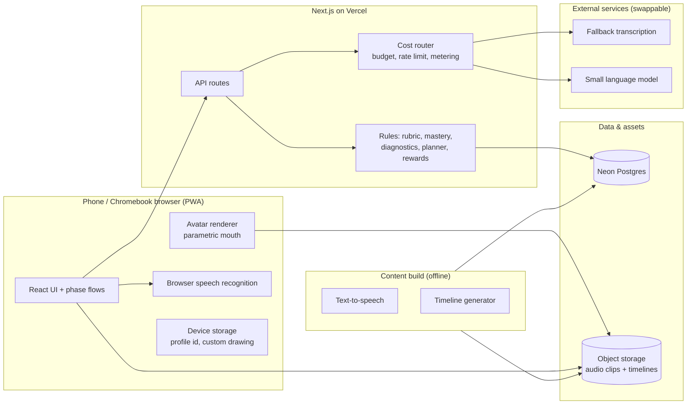
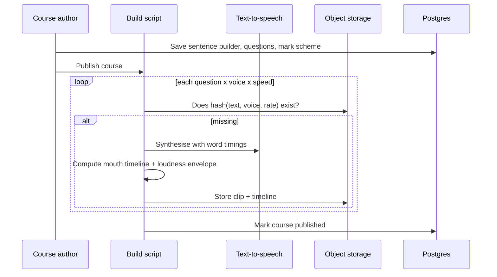
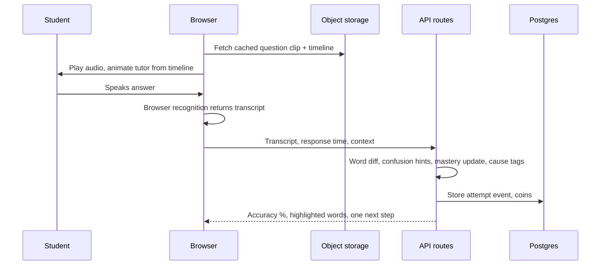

# Architecture Requirements and Decisions: My Spanish Tutor

| | |
|---|---|
| **Version** | 1.0 (bootcamp submission) |
| **Date** | 29 October 2026 |
| **Author** | [your name] |
| **Status** | Accepted for v1 |
| **Related** | `docs/PRD.md`, `openspec/changes/ks3-spanish-speaking-tutor-v1/` |

This document sets out the architecture requirements for My Spanish Tutor v1 and records each significant decision with its alternatives and consequences.

---

## 1. Context

A phone-first web app for Year 8 Spanish speaking-test revision (see the PRD). It is built by one developer in two weeks on a budget of about £30, with an eye on scale: the aim is to show that the design can serve many students at near-zero marginal cost.

### 1.1 Technical constraints

- Solo developer; known stack: TypeScript, React, Next.js, Node, REST, Neon Postgres, Vercel.
- Primary client is a phone browser; secondary is an old school Chromebook with a cheap headset or the built-in microphone in a noisy room.
- Users are 12 to 13 years old; data protection obligations (UK GDPR, ICO Children's Code) apply.
- Paid services must stay within a total of about £30 across build and testing.
- An unofficial text-to-speech tool was used for prototyping only and must not ship.

### 1.2 Evidence already gathered

A browser prototype compared three lip-sync models on a real Spanish clip. The model with jaw movement driven by audio loudness and lip shapes driven by visemes, with the mouth leading the audio by 30 ms, a mouth speed of 32 and shapes under 70 ms dropped, was judged correct by the developer. A previous approach using one mouth shape per phoneme had failed.

## 2. Architecture requirements

Quality attributes drive the design. Each is stated so that it can be tested.

| ID | Requirement | Why it matters |
|---|---|---|
| AR-1 | **Cost.** Live practice loops make no language-model calls and no per-request speech synthesis. Every paid call is metered, capped and has a fallback. | Scale story and budget |
| AR-2 | **Privacy.** No real names, emails or audio recordings are stored. Interests are fixed tags. Everything a student created can be deleted in one action. | Children's data |
| AR-3 | **Latency.** Spoken-attempt feedback appears within about two seconds of the end of speech on a mid-range phone. | Feels like a game |
| AR-4 | **Sync.** Mouth movement stays aligned with audio at 0.5x, 0.75x and 1x speed on every supported device. | Credibility of the tutor |
| AR-5 | **Device coverage.** Works on current Android Chrome, iOS Safari and Chromebook Chrome with a headset or built-in microphone. | Real student devices |
| AR-6 | **Resilience.** Each external dependency has a specified degraded mode: missing audio shows text, drafting failure shows model answers, recognition failure allows a free retry. | Homework must not break |
| AR-7 | **Determinism.** Marking (rubric level, accuracy, mastery, cause tags) is rule-based and explainable to a student. | Trust and fairness |
| AR-8 | **Replaceability.** Speech recognition, speech synthesis and language-model providers sit behind interfaces. | Vendors and prices change |
| AR-9 | **Observability.** Every attempt and every external call is logged for diagnostics and cost reporting. | Cost-per-student figure |
| AR-10 | **Delivery.** A single vertical slice can be delivered in two weeks, with stretch features isolated. | Schedule |

## 3. System overview

### 3.1 Components

| Component | Responsibility |
|---|---|
| **React UI** | Join flow, plan, the four phases, rewards; installable PWA |
| **Avatar renderer** | Draws the tutor's mouth from continuous parameters, driven by the audio clock |
| **Browser speech recognition** | Primary transcript source; free and instant |
| **API routes** | Thin REST layer: courses, attempts, drafts, plans, rewards, reports |
| **Rules modules** | Pure functions: spelling to mouth units, syllables, rubric levels, word-diff scoring, mastery, diagnostic tags, planner, coin ledger |
| **Cost router** | Wraps every paid call: budget check, per-profile rate limit, cost log, fallback |
| **Content build** | Offline scripts that synthesise audio and compute timelines before a course is published |
| **Neon Postgres** | Relational data (section 5) |
| **Object storage** | Audio clips and mouth timeline JSON keyed by content hash |

## 4. Key flows

### 4.1 Publishing a course (offline, once)

### 4.2 A spoken attempt (live, no model calls)

If browser recognition is unavailable, the clip is sent to a fallback transcription call through the cost router and discarded after the response.

### 4.3 Drafting an answer (the only model-call path in the learning loop)

1. Student states confidence and minutes per day.
2. The router checks budget and rate limit.
3. The model receives the chunk bank, level, length target and interest tags, and returns structured output.
4. Code validates every word against the allowed set and recomputes the rubric level.
5. An invalid draft is regenerated once; after that the student receives model answers for the course.

## 5. Data model (summary)

| Entity | Key fields |
|---|---|
| `course` | id, class code, owner token hash, test date, cheeky pool flag |
| `chunk` | course id, Spanish, English gloss, category, feature tags, recycled flag |
| `question` | course id, Spanish, English subtitle, order, recycled flag |
| `profile` | random id, nickname, interest tags, recovery code hash, created at |
| `answer` | profile id, question id, text, level, confirmed at |
| `attempt` | profile id, item, phase, outcome, accuracy, response time, voice, speed, assisted flag, cause tags, session id |
| `mastery` | profile id, item, phase, qualifying successes, distinct sessions |
| `plan` | profile id, minutes per day, days left, scheduled sessions |
| `coin_ledger` | profile id, amount, reason, created at (append-only) |
| `inventory` | profile id, item, acquired at |
| `phrase_bank` | persona id, situation key, Spanish line, English subtitle, clip id |
| `cost_log` | service, tier, units, estimated cost, course id, profile id, created at |

No table holds a real name, email address or recording.

## 6. Architecture decision records

Each record states the decision, the alternatives considered, and the consequences.

### ADR-1. Next.js progressive web app on Vercel

- **Status:** Accepted
- **Decision:** One TypeScript codebase for UI and API, deployed as a PWA on Vercel with Neon Postgres and object storage.
- **Alternatives:** Native iOS and Android apps (slower to build, app store friction for a school pilot); separate API service (more to operate in two weeks).
- **Consequences:** Fast iteration and zero install friction for the school pilot. Limited access to some native device features; acceptable for v1.

### ADR-2. Anonymous profiles instead of user accounts

- **Status:** Accepted
- **Decision:** A random profile ID in device storage, mirrored by a server record, with a short recovery code. Course owners use an unguessable owner link. Students join with a class code.
- **Alternatives:** Email and password (collects personal data of children); school single sign-on (heavy, slows adoption, larger data-protection surface).
- **Consequences:** Solves the data-protection problem by not holding identifying data. A lost phone without a recovery code loses progress, which is accepted.

### ADR-3. Cost router around every external call

- **Status:** Accepted
- **Decision:** All paid calls pass through one module that checks budget, applies a per-profile rate limit, logs service, size and estimated cost, and applies a fallback when capped. Tiers, cheapest first: stored result, rules, speech recognition, small language model, large model.
- **Alternatives:** Calling services directly from features (cost invisible, no consistent caps).
- **Consequences:** The cost-per-student figure comes straight from the log. Slight overhead for each call, and every new paid call needs a fallback defined.

### ADR-4. Speech recognition behind an interface, browser first

- **Status:** Accepted
- **Decision:** Use the browser's built-in recogniser as primary; fall back to a server transcription call for short in-memory clips on unsupported devices.
- **Alternatives:** Always server-side (cost and latency); a pronunciation-scoring service (unneeded detail, see ADR-5).
- **Consequences:** Free and fast on most devices. Quality varies by device, so an early spike on real devices decides which need the fallback.

### ADR-5. Shallow pronunciation feedback

- **Status:** Accepted
- **Decision:** Score by word-level difference between the transcript and the student's script. A word is matched when the recogniser understood it. A small table of known English-speaker confusions gives one-line tips. Syllable splitting is rule-based.
- **Alternatives:** Phoneme-level pronunciation assessment (cost and complexity, few marks at this level, risk of demoralising feedback).
- **Consequences:** Cheap, fair and explainable. It will not catch subtle accent issues, which is acceptable for KS3.

### ADR-6. Pre-generated audio with content-hash caching

- **Status:** Accepted
- **Decision:** At publish time synthesise each question in two or more voices at three speeds (using speaking-rate control, not time-stretching) and store clips keyed by a hash of text, voice and rate. A student's own answers are voiced once on demand and cached.
- **Alternatives:** Synthesise on each request (cost and latency); browser-built-in voices (inconsistent quality, no timing data).
- **Consequences:** Near-zero marginal audio cost per student. Changing a question text requires regeneration. The prototype voice is unofficial and will be replaced after a listening test.

### ADR-7. Precomputed lip-sync timelines with a parametric mouth

- **Status:** Accepted, validated by prototype
- **Decision:** Each clip carries a timeline of word times, syllable nuclei aligned to loudness peaks, a few mouth-shape targets, and a downsampled loudness envelope. The mouth is drawn from continuous parameters (width, openness, rounding, press, smile, teeth, tuck) and eased by a spring. The jaw follows loudness; lip shapes change only for closed lips, rounded lips and teeth-on-lip. Settings: mouth leads audio by 30 ms, mouth speed 32, shapes under 70 ms dropped. Animation reads the audio clock every frame.
- **Alternatives:** One sprite per phoneme (failed earlier because transitions between shapes are not regular in time); runtime audio analysis only (less consistent across devices); vendor viseme events (tied to one voice vendor).
- **Consequences:** Deterministic, fast, works at any playback speed, and the same mouth system can animate a student's own drawing. Needs a small, tested spelling-to-mouth module for Spanish.

### ADR-8. Rubric from tagged chunks

- **Status:** Accepted
- **Decision:** Each chunk in the sentence builder carries feature tags (opinion, justification, connective, sequencer, adjective, tense, idiom). The level of an answer is computed by counting tagged chunks used.
- **Alternatives:** A language model judging the Spanish (cost, inconsistency, not explainable).
- **Consequences:** Deterministic and explainable. Authoring a course requires tagging chunks.

### ADR-9. Language model only for writing support and content generation

- **Status:** Accepted
- **Decision:** A small model drafts answers (structured output), generates each persona's phrase bank once, and, if built, converts a sentence-builder photo into chunks. Code validates all output. Student free text is never sent to a model.
- **Alternatives:** A conversational model in the practice loop (cost per student, safety exposure, unpredictable content).
- **Consequences:** Language-model cost is bounded and predictable. The tutor cannot improvise; its lines are authored in advance.

### ADR-10. Mastery as evidence across separate sessions

- **Status:** Accepted
- **Decision:** Each item records qualifying successes and the distinct sessions they occurred in. Default threshold: three successes across two sessions, configurable. In-session spaced return, next-session queue.
- **Alternatives:** Advance on first success (the PRD requires embedding, not one-off recall).
- **Consequences:** Better retention and a truthful readiness meter, at the cost of slower visible progress, which rewards and mood support must offset.

### ADR-11. Diagnostics from small event data and a closed tag list

- **Status:** Accepted
- **Decision:** Every attempt is an event. Cause tags come from rules over probe variations (slow word alone, normal word alone, word in sentence), timed versus untimed outcomes and the latest mood check-in. The tag set is closed.
- **Alternatives:** Free-form analysis by a model (cost, inconsistency); no causes (misses the "why" the product depends on).
- **Consequences:** Cheap, testable and sufficient for both adaptation and the teacher overview.

### ADR-12. Rewards as an append-only coin ledger

- **Status:** Accepted
- **Decision:** Coins are ledger entries earned for effort and improvement. Rank derives from rolling average response time. Packs use a server-side odds table and spend only coins. No real-money path exists.
- **Alternatives:** Mutable balances (hard to audit); public leaderboards (shaming, anxiety); hearts (punishing for fearful learners).
- **Consequences:** Auditable, safe for children, and easy to tune.

### ADR-13. Data-protection artefacts delivered with the code

- **Status:** Accepted
- **Decision:** A short impact assessment, a student-readable privacy notice and a delete-everything action ship with v1. Third-party services are used with no-retention settings where offered.
- **Alternatives:** Defer to later (unacceptable for a children's product).
- **Consequences:** Small up-front effort, and a visible strength in a school sales conversation.

### ADR-14. Testing strategy

- **Status:** Accepted
- **Decision:** Pure logic (syllables, mouth targets, rubric, scoring, mastery, diagnostics, cost routing) gets unit tests. Speech and audio get a manual device matrix. One scripted end-to-end run covers all four phases on a seeded course. A test asserts that practice rounds make no language-model call.
- **Alternatives:** Manual testing only (regressions in rule modules).
- **Consequences:** The rule modules, where correctness matters most, are well covered; device behaviour is verified by hand.

## 7. Cost architecture

| Tier | Used for | Cost behaviour |
|---|---|---|
| 0. Stored result | Question audio, timelines, phrase banks, parsed sentence builders | Paid once, free thereafter |
| 1. Rules | Scoring, mastery, diagnostics, rewards, planning, syllables | Free |
| 2. Speech recognition | Browser first; short fallback calls only when needed | Free or small |
| 3. Small language model | Answer drafts, persona banks, optional photo import | Per draft; bounded by caps |
| 4. Large model | Rare authoring tasks only | Negligible |

The measured cost per student per test cycle will be reported from the cost log during user testing. No price figure in this document has been verified against a vendor's official page; current prices must be checked before relying on them.

## 8. Privacy architecture

- No names, emails, phone numbers or school identifiers are collected.
- Interests are chosen from a fixed list; free text never reaches a model.
- Student speech is held in memory for one processing call and then discarded.
- Custom drawings never leave the device.
- A delete-everything action removes all server rows for a profile.
- Course owners see nicknames and progress only, through an unguessable link not exposed in the student app.
- Hosting is in a UK or EU region where available.

## 9. Deployment

- **Environments:** preview deployment per branch; one production deployment for user testing.
- **Database:** additive migrations on Neon; a database branch per preview where useful.
- **Assets:** object storage with immutable, content-hashed keys.
- **Rollback:** redeploy the previous Vercel build; migrations are additive, so rollback does not lose data.
- **Seeding:** one script creates the demo course and can be re-run safely.

## 10. Risks and trade-offs

| Risk | Impact | Mitigation |
|---|---|---|
| Recognition quality on iPhone or noisy rooms | Unfair scores, frustration | Early device spike; fallback recogniser; free retry |
| Unofficial prototype voice | Cannot ship | Listening test and a licensed voice before launch; build script isolates the provider |
| Language model produces out-of-bank Spanish | Misleads students | Word validator; model-answer fallback |
| Two-week schedule | Incomplete features | Vertical slice first; stretch items isolated |
| Anonymous profiles lose data on lost devices | Annoyance | Recovery code; accepted trade-off |
| Vendor prices not verified | Cost misestimate | Measure real usage; verify prices before pricing the product |
| Copyright of teaching material | Legal exposure | Developer-authored content only in v1 |

## 11. Open questions

- Which production voices to use (decided by listening test).
- Which fallback recogniser to use (decided by the device spike).
- Rank thresholds for response time (tuned from user-testing data).

## Appendix A. Lip-sync algorithm summary

1. Convert each word's Spanish spelling to mouth units by rules: five vowels (a; e and i; o; u), closed lips for m, b, p, v, teeth on lip for f, other consonants as minor shapes. Silent h, qu, gu and ll are handled by rule.
2. Group vowels into syllable nuclei: diphthongs share one nucleus, adjacent strong vowels and accented weak vowels split.
3. Place each nucleus on the loudest moment of its share of the word's time window; place consonants between nuclei.
4. Drop minor shapes shorter than the minimum hold; always keep closed-lip and teeth-on-lip shapes.
5. At playback, read the audio clock each frame, look up the active shape at the clock plus the lead, ease every mouth parameter with a spring, and drive jaw openness from the loudness envelope.
