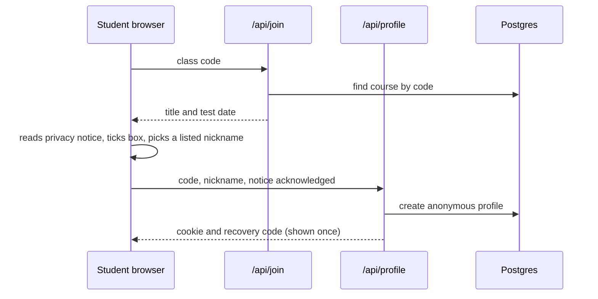
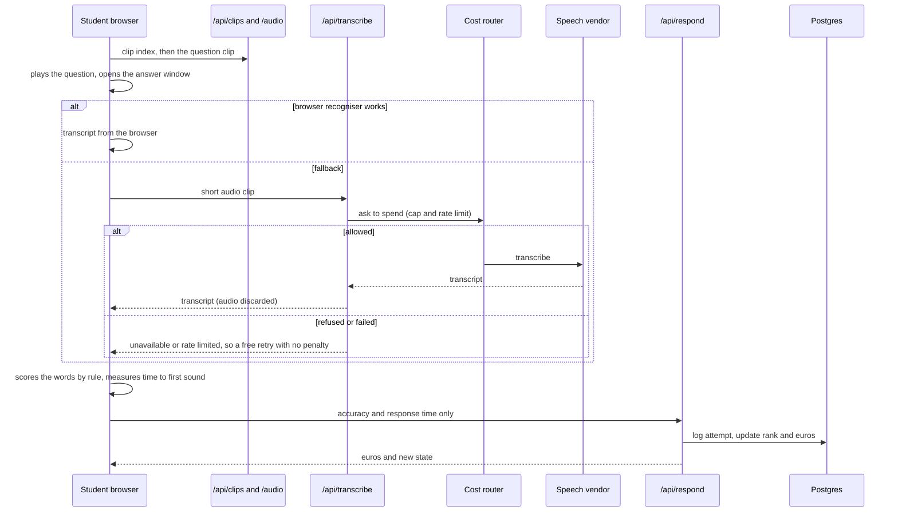
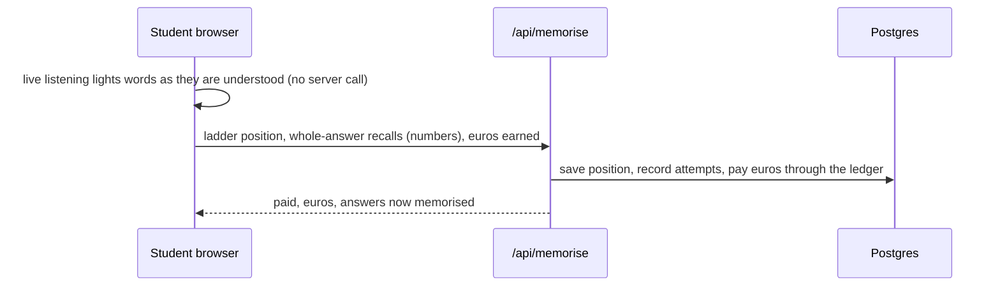
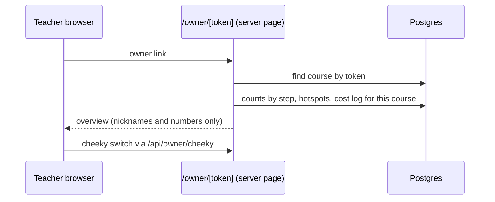

# API map (task 25.1)

Every route handler under `app/api`, checked against the route files on 13 Nov 2026 (15 route files, 16 handlers). There is no separate API service (design D23): the browser talks to these handlers, which run as Vercel functions beside the pages.

Three rules hold for every route:

- **Auth.** "Cookie" means the anonymous profile cookie read by `currentProfile()`; no cookie gives 401. There are no accounts, names or emails. The only other credential is the unguessable **owner token** for a course.
- **No audio, no transcript, no free text.** The browser scores speech and sends only numbers. The one exception is `/api/transcribe`, which receives a short clip, processes it in memory and discards it.
- **Cost router.** The only route that makes a paid call from a student's device is `/api/transcribe`, and it goes through the cost router. No other route calls a language model or a speech vendor. A test fails if a model call is added to the practice loop (`lib/cost/no-model-in-practice.test.ts`).

## Routes

| Route | Method | Trigger | Called from | Writes or calls | Auth | Cost router | Not called when |
|---|---|---|---|---|---|---|---|
| `/api/join` | POST | Student enters a class code | `app/welcome/WelcomeForm.tsx` | Reads the course by code. Creates nothing | None (code only) | No | Demo mode; a student who already has a profile |
| `/api/profile` | POST | Student picks a nickname and ticks the privacy notice | `WelcomeForm.tsx` | Creates the profile, sets the cookie, returns the recovery code once | None (valid code and notice acknowledged) | No | Demo mode |
| `/api/profile` | DELETE | "Delete everything" | `app/privacy/DeleteEverything.tsx` | Deletes the profile and all its rows, clears the cookie | Cookie | No | Never called by itself |
| `/api/profile/restore` | POST | Student enters a recovery code on a new device | `app/restore/RestoreForm.tsx` | Reads the profile, sets the cookie | Recovery code | No | Same device with the cookie still set |
| `/api/baseline` | POST | One answer in the starting-point check | `app/baseline/Baseline.tsx` | Saves a diagnostic answer. No coins, no mastery | Cookie | No | A student who skips the check |
| `/api/clips` | GET | Any screen that plays audio loads the clip index | `Baseline`, `Understand`, `Automate`, `useWordAudio` | Reads the built clip list. Writes nothing. Cached 60 s | None | No | Screens that need no audio. The demo still calls it (read only) |
| `/api/clip-failure` | POST | A clip would not load | `Understand`, `Automate` | Stores the clip slot only | Cookie optional | No | When every clip loads; never in demo mode |
| `/api/answers` | POST | Student saves or confirms a written answer | `app/phases/write/Write.tsx` | Re-checks the answer with the rubric (rules) and saves it | Cookie | No | Nothing is typed. No model call |
| `/api/attempts` | POST | One question-comprehension attempt | `app/phases/understand/Understand.tsx` | Logs the attempt event, updates mastery, awards euros | Cookie | No | Placement check and probes, which use other routes |
| `/api/probe` | POST | Short probe after a missed question | `Understand.tsx` | Works out the cause tag by rule and saves it on the missed attempt. Never counts toward mastery or euros | Cookie | No | The question was right first time |
| `/api/recall` | POST | One whole-answer recall in the classic memorise screen | `app/phases/memorise/Memorise.tsx` | Records the percentage and missed words | Cookie | No | The ladder screen is used instead (it calls `/api/memorise`) |
| `/api/memorise` | POST | End of a ladder screen, a lesson, or leaving | `app/phases/memorise/MemorisePhase.tsx` | Saves ladder position, records whole-answer attempts as recalls, pays euros (capped) | Cookie | No | Demo and lab, which keep progress in the browser |
| `/api/respond` | POST | One timed hear-and-answer attempt | `app/phases/automate/Automate.tsx` | Logs the attempt and response time, updates rank and window, pays euros | Cookie | No | Demo mode, which works out rank and euros on the page |
| `/api/shop` | POST | Buy an item or choose a wallpaper | `app/shop/Shop.tsx` | Takes euros at a fixed price, records the item | Cookie | No | Demo mode, which has its own pretend shelf |
| `/api/transcribe` | POST | The device cannot use browser recognition, or it failed, so a short clip is sent | `app/components/useSpeechCapture.ts` | Sends the clip to the speech vendor, returns a transcript, stores nothing about the audio | Cookie (optional, for the rate limit) | **Yes**: service `transcription`, cap and rate limit in `lib/cost-router/limits.ts` | The browser recogniser works (the normal case on verified devices); demo mode never records |
| `/api/owner/cheeky` | POST | The teacher flips the cheeky-phrases switch on the overview | `app/owner/[token]/CheekySwitch.tsx` | Sets the course's cheeky-pool flag | Owner token | No | The student app never calls it |

## Pages that read the database directly

These are server components, not API routes, so they do not appear above. The teacher overview (`/owner/[token]`) reads class counts, hotspots and the cost report with the owner token. With `?demo=1`, and on `/demo/teacher`, it shows made-up sample data and reads nothing. Every other `/demo` page is isolated: it creates no profile and makes no non-GET API call (tests assert this).

## Sequence diagrams

### Join

### Hear and answer, with speech recognition

### Memorise ladder

### Teacher overview and cost

## Build-time and script calls (not routes)

Course set-up, the audio build and the cost report are run by scripts on the teacher's behalf (design D21), never by a student's device. They also go through the cost router (`course-setup` and `elevenlabs-tts` services). See `docs/audio-pipeline.md` and `docs/teacher-flow.md`.
