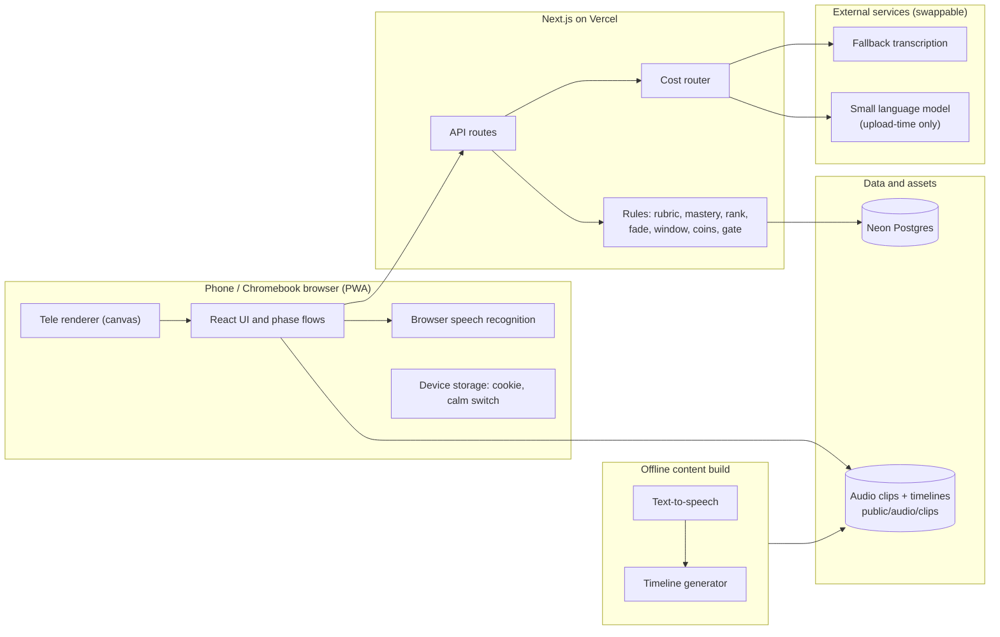
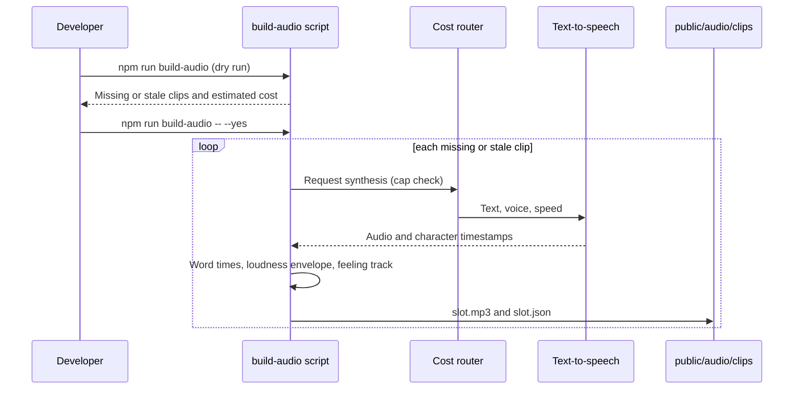
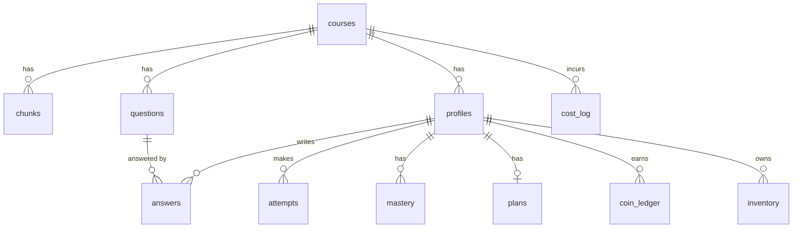
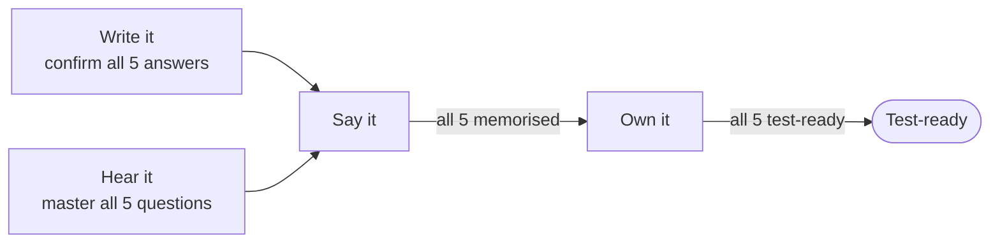

# My Spanish Tutor: Technical Documentation

| | |
|---|---|
| **Product** | My Spanish Tutor v1 |
| **Document type** | Technical reference for developers, maintainers and reviewers |
| **Version** | 1.0 |
| **Audience** | Engineers who build, run or extend the app; teachers' technical contacts; assessors |
| **Source of truth** | `openspec/changes/ks3-spanish-speaking-tutor-v1/` (requirements), `docs/ARD.md` (decisions), the code |

This document describes the finished v1 system. Where it needs to say *why*, it points to the design decision (D1 to D15 in `design.md`) or the ADR in `docs/ARD.md`. Behaviour is stated as testable requirements in the OpenSpec specs; this document does not repeat the acceptance scenarios, it explains how the system meets them.

> **Where the sources disagree.** `docs/ARD.md` (29 October) describes a tutor with an animated mouth and lip-sync. The later design work replaced that with Tele, a mouthless character (design D7). **This document follows `design.md`.** The mouth parameters (30 ms lead, speed 32, 70 ms minimum shape) no longer apply to v1 and are not implemented. `CLAUDE.md` still lists them and should be updated to match.

---

## Contents

1. [What the system does](#1-what-the-system-does)
2. [Design principles and hard rules](#2-design-principles-and-hard-rules)
3. [Architecture](#3-architecture)
4. [Technology stack](#4-technology-stack)
5. [Repository layout](#5-repository-layout)
6. [Getting started](#6-getting-started)
7. [Configuration](#7-configuration)
8. [Data model](#8-data-model)
9. [The learning path](#9-the-learning-path)
10. [Core modules](#10-core-modules)
11. [Speech and audio](#11-speech-and-audio)
12. [Tele, the tutor character](#12-tele-the-tutor-character)
13. [Cost control](#13-cost-control)
14. [Privacy and data protection](#14-privacy-and-data-protection)
15. [HTTP API reference](#15-http-api-reference)
16. [Accessibility, performance and devices](#16-accessibility-performance-and-devices)
17. [Testing](#17-testing)
18. [Build, deployment and operations](#18-build-deployment-and-operations)
19. [Extending the system](#19-extending-the-system)
20. [Troubleshooting](#20-troubleshooting)
21. [Known limitations and open questions](#21-known-limitations-and-open-questions)
22. [Glossary](#22-glossary)

---

## 1. What the system does

My Spanish Tutor is a phone-first web app that helps UK Year 8 students (age 12 to 13) revise for one KS3 Spanish speaking test at a time. It also runs on old school Chromebooks with a headset.

A **course** is one sentence builder (a bank of Spanish chunks), exactly five test questions and a mark scheme. A student joins a course, then works through four gated phases:

| Phase | Student goal | Phase ID |
|---|---|---|
| **Write it** | Choose and confirm a Spanish answer they can realistically say, for each of the five questions | `write` |
| **Hear it** | Understand each question by ear, at increasing speeds | `understand` |
| **Say it** | Recall their own answer from an English prompt, with the script fading away | `memorise` |
| **Own it** | Answer the heard question quickly and from memory, under a shrinking time window | `automate` |

Around the phases sit the supporting capabilities: a revision planner and readiness meter, diagnostics (why an error happened), a coin-based reward system, a cost-control layer, and a read-only teacher overview.

The tutor is **Tele**, an original character: an old television with one large eye. Tele speaks only Spanish; English appears only as subtitles.

### 1.1 Capabilities at a glance

The 14 OpenSpec capabilities and where each is implemented:

| Capability | Main code | Notes |
|---|---|---|
| `course-content` | `lib/course/`, `lib/course/calibration/` | Schema validation, seed, calibration data |
| `student-identity-privacy` | `lib/profile/`, `lib/session/`, `app/welcome/`, `app/restore/` | Anonymous profile, recovery code |
| `speech-audio-assets` | `lib/audio/`, `scripts/build-audio.mjs`, `lib/tele/clip*.ts` | Offline build, content-hash cache |
| `answer-writing-coach` | `lib/coach/`, `app/phases/write/` | Rubric, validator, model answers |
| `question-comprehension` | `lib/mastery/`, `lib/understand/`, `app/phases/understand/` | Hear then choose |
| `answer-memorisation` | `lib/memorise/`, `app/phases/memorise/` | Scaffold fading |
| `response-automatisation` | `lib/automate/`, `app/phases/automate/` | Timed rounds, rank |
| `spoken-answer-feedback` | `lib/speech/`, `lib/spanish/`, `lib/transcription/` | Scoring, confusions, syllables |
| `learning-diagnostics` | `lib/events/` | Attempt events, closed cause-tag list |
| `revision-planner` | `lib/phases/`, `lib/progress/`, `lib/server/home.ts` | Countdown, readiness |
| `tutor-avatar` | `lib/tele/`, `app/components/Tele.tsx` | Canvas character |
| `engagement-rewards` | `lib/coins/`, `lib/automate/rank.ts` | Append-only ledger |
| `usage-cost-control` | `lib/cost-router/` | Caps, rate limits, logging |
| `teacher-overview` | Owner-link route reading `attempts`, `mastery`, `cost_log` | Read-only |

---

## 2. Design principles and hard rules

These rules shape every module. They are enforced by code and tests where possible, not only by convention.

| # | Rule | How it is enforced |
|---|---|---|
| R1 | **The tutor never speaks English.** Tutor audio is Spanish; English is subtitle text only. | The audio manifest only plans Spanish text; the caption component renders the subtitle as text. |
| R2 | **No personal data.** No names, emails, phone numbers, school IDs or audio recordings are stored. | Schema has no such columns; the nickname comes from a generated list; the transcribe route holds audio in memory only (test in `lib/transcription/transcribe.test.ts`). |
| R3 | **Interests are fixed tags, never free text.** | The join flow no longer asks for interests (19.4); if they return they stay fixed tags, with no text field. |
| R4 | **The practice loop makes no language-model call.** | There is no model client in the request path of any phase route. A test (task 14.3) fails if a practice round calls one. |
| R5 | **Scores come from rules, not a model.** A word is matched if the recogniser understood it. A recognition failure or noise is never penalised. | `lib/speech/score.ts`, `lib/speech/capture-judgement.ts`. |
| R6 | **Every paid call goes through the cost router.** | `createCostRouter` throws if a service has no configured cap. |
| R7 | **No hearts, lives, public ranking, random draws or real-money payments.** | None exist in the schema or routes. Coins are an append-only ledger. |
| R8 | **No grades or levels are shown.** Students see only the value of an answer, which grows as they add detail. There are no level names or ladders. | A test fails if a screen mentions grades. |
| R9 | **No copyrighted characters.** Original persona only. | Single character, no persona picker. Image assets logged in `docs/asset-credits.md` (test-enforced). |
| R10 | **Tone is cheeky but school-safe, encouraging, and names at most one thing to fix per attempt.** | Feedback builders return a single next step (`lib/memorise/feedback.ts`). |
| R11 | **Play earns nothing.** Poking Tele or exploring the desktop gives no coins or progress. | Coins are awarded only inside attempt and session handlers. |

---

## 3. Architecture

### 3.1 System overview



One TypeScript codebase serves both the UI and the API (design D1). The browser does the work that is free and instant (speech recognition, scoring, drawing Tele); the server stores events and applies the rules that must be trusted (mastery, coins, gating); paid services are reached only through the cost router.

### 3.2 Request lifecycle

Every authenticated route follows the same shape:

1. Read the `profile` cookie (an httpOnly random UUID) with `currentProfile()`; return `401` if absent.
2. Parse and validate the JSON body; return `400` on a bad shape.
3. Check that the referenced item belongs to the profile's course (`404` otherwise).
4. Call a store function in `lib/` that applies the rule and writes to Postgres.
5. Return JSON with `Cache-Control: no-store`.

Routes are deliberately thin. Business rules live in `lib/` as pure functions so they can be unit-tested without a database or browser.

### 3.3 A spoken attempt (live, no model calls)

```mermaid
sequenceDiagram
  participant S as Student
  participant B as Browser
  participant C as Clip store
  participant A as API route
  participant D as Postgres
  B->>C: Fetch question clip and timeline
  B->>S: Play audio; Tele glows with the loudness envelope
  S->>B: Speaks answer
  B->>B: Recognise speech, score transcript against the script
  B->>A: Accuracy, response time, item and session ids
  A->>A: Apply mastery, fade, window or rank rules
  A->>D: Store attempt event and coins
  A-->>B: Mastery state, coins, next step
```

Only numbers and identifiers cross to the server. **No audio and no transcript** are sent on the normal path. The server-side fallback (section 11.3) is the one exception, and it holds the clip in memory for the single call.

### 3.4 Offline content build



---

## 4. Technology stack

| Layer | Choice | Version (from `package.json`) | Rationale |
|---|---|---|---|
| Framework | Next.js (App Router) | ^16.4.3 | One codebase for UI and API; PWA; serverless fits spiky homework traffic (D1) |
| UI | React | ^19.3.1 | Known stack |
| Language | TypeScript | ^7.0.2 | Typed rule modules |
| Database | Neon Postgres via `pg` | pg ^8.23.1 | Relational data, branching for safe migration trials |
| Hosting | Vercel | n/a | Preview per branch; auto-deploy from `main` |
| Unit tests | Vitest | ^5.0.5 | Fast pure-logic tests |
| Browser tests | Playwright | ^1.64.1 | Phone and Chromebook profiles with a fake microphone |
| Test database | PGlite | ^0.5.14 | In-process Postgres so tests never touch Neon |
| Text-to-speech | ElevenLabs (build time only) | n/a | Licensed character voice with per-character timestamps (D6) |
| Fallback transcription | OpenAI transcription | n/a | Behind an interface; vendor still open (section 21) |
| Runtime | Node.js 24 | n/a | What the project is developed and tested on |

The Vercel runtime default (Node.js on Fluid Compute) is used. No route sets `runtime = 'edge'`.

---

## 5. Repository layout

```
app/
  api/                 HTTP routes (section 15)
  phases/              write/, understand/, memorise/, automate/ and the [phase] gate page
  components/          Desktop, Tele, Caption, Win, CalmSwitch; speech and playback hooks
  welcome/, restore/   Join and recovery screens
  lab/, spike/         Developer-only pages (Tele lab, speech spike)
  tokens.css           The single dreamcore design-token set
  accessibility.css    Learner-controlled accessibility layer (separate from the theme)
db/migrations/         Additive SQL migrations, 0001 to 0006
docs/                  PRD, ARD, design, pipelines, decisions, this document
lib/
  audio/               Clip planning, hashing, build orchestration
  automate/            Response window, rank, repeat phrase, round order, onset
  coach/               Rubric, word validator, model answers, swaps, set-up call
  cost-router/         Budget, rate limit and logging wrapper
  course/              Schema, seed, calibration data
  events/              Attempt events and cause tags
  mastery/             Cross-session mastery and spaced return
  memorise/            Scaffold fading, feedback, chunk isolation
  phases/              Gate (unlock rules)
  profile/             Anonymous profiles and recovery
  progress/            Progress and readiness
  speech/              Scoring, confusions, recognition path, capture judgement
  spanish/             Syllable and stress rules
  tele/                Character renderer, timelines, phrase bank, feelings
  transcription/       Server-side fallback transcriber
scripts/               migrate, seed, build-audio, check-budget, voice-audition
tests/                 Playwright end-to-end specs
openspec/              Requirements, design and tasks for v1
```

Convention: **rules in `lib/`, I/O in `app/`**. A module in `lib/` that needs the database takes a `Db` argument (`lib/db/types.ts`) so tests can pass PGlite.

---

## 6. Getting started

### 6.1 Prerequisites

- Node.js 24 and npm
- A Neon Postgres project (use a **branch** of the main database for local work)
- Optional, only for the audio build and the speech fallback: ElevenLabs and OpenAI API keys

### 6.2 First run

```bash
git clone https://github.com/pjfpotter/my-spanish-tutor.git
cd my-spanish-tutor
npm ci
cp .env.example .env        # then fill in DATABASE_URL and DATABASE_URL_UNPOOLED
npm run db:migrate          # create the tables
npm run seed                # load the hand-authored course (safe to re-run)
npm run dev                 # http://localhost:3000
```

### 6.3 Scripts

| Command | Purpose |
|---|---|
| `npm run dev` | Development server |
| `npm run build` / `npm start` | Production build and server |
| `npm run typecheck` | TypeScript check, no emit |
| `npm test` | Unit tests (Vitest); needs no database or browser |
| `npx playwright test` | Browser tests on their own server at port 3100 |
| `npm run db:migrate` | Apply new SQL files from `db/migrations/` |
| `npm run seed` | Write `lib/course/seed.ts` to the database, updating in place |
| `npm run build-audio` | **Dry run.** Lists missing or stale clips and the estimated cost; spends nothing |
| `npm run build-audio -- --yes` | Builds missing or stale clips (paid, through the cost router) |
| `npm run check:budget` | Fails if the performance budget (section 16.2) is exceeded |
| `npm run audition` | Compare candidate voices (`scripts/voice-audition.mjs`) |

---

## 7. Configuration

All configuration is by environment variable. `.env` and `.env.local` are gitignored; never commit them. On Vercel, set the same names in the project's Environment Variables.

| Variable | File | Required | Used by |
|---|---|---|---|
| `DATABASE_URL` | `.env` | Yes | App. Neon **pooled** connection string |
| `DATABASE_URL_UNPOOLED` | `.env` | For migrations | `npm run db:migrate`. Neon **direct** string (host without `-pooler`) |
| `ELEVENLABS_API_KEY` | `.env.local` | For audio build | `scripts/build-audio.mjs` |
| `ELEVENLABS_VOICE_TELE` | `.env.local` | For audio build | Tele's voice ID |
| `ELEVENLABS_MODEL` | `.env.local` | No | Defaults to `eleven_multilingual_v2` |
| `OPENAI_API_KEY` | `.env.local` / Vercel | For fallback | `POST /api/transcribe`. If unset the route returns `503 not_configured` |
| `OPENAI_TRANSCRIBE_MODEL` | any | No | Overrides the transcription model |
| `TRANSCRIBE_COST_PER_SECOND_GBP` | any | No | Cost estimate per second of audio; default `0.0001` (unverified) |
| `DB_DRIVER` | test only | No | `pglite` selects the throwaway in-process database. Playwright sets this |

Behavioural settings that are **data, not environment**: mastery thresholds, the response-window limits, rank boundaries, and the rubric's features and thresholds. See sections 10 and 19.

---

## 8. Data model

The schema is built from additive migrations in `db/migrations/`. `npm run db:migrate` applies each file once, in order, and records it in `schema_migrations`. Additive-only migrations mean a Vercel rollback never loses data.

| Migration | Change |
|---|---|
| `0001_initial.sql` | All core tables, the append-only coin trigger |
| `0002_cost_log_outcome.sql` | `cost_log.outcome` (`ok`, `cap_reached`, `rate_limited`, `error`) |
| `0003_chunk_unique.sql` | Unique `(course_id, spanish)` so re-seeding updates rather than duplicates |
| `0004_help_use_and_clip_failures.sql` | `attempts.replays`, `used_slow`, `revealed`; `clip_failures` table |
| `0005_model_answers.sql` | `courses.model_answers` (hand-authored fallback answers) |
| `0006_calibration.sql` | `courses.mark_scheme` renamed to `calibration` |

### 8.1 Entity relationships



### 8.2 Tables

| Table | Purpose | Key points |
|---|---|---|
| `courses` | One sentence builder and its settings | `class_code` unique; `owner_token_hash` (the owner link is hashed at rest); `calibration` jsonb; `model_answers` jsonb `[{questionPosition, rung, text}]`; `cheeky_pool` flag; `unlock_all` flag (testing course, default false) |
| `chunks` | Sentence-builder chunks | `spanish`, `english_gloss`, `category`, `feature_tags text[]`, `recycled` |
| `questions` | Exactly five per course | `position` unique within course; `english_subtitle`; `recycled` |
| `profiles` | Anonymous student | Random UUID, generated `nickname`, `interest_tags` (fixed list), `recovery_code_hash` unique. **No name, email or school ID** |
| `answers` | A student's chosen answer per question | Unique `(profile_id, question_id)`; `confirmed_at` set at the confirmation gate |
| `attempts` | One row per practice attempt | `item_kind` (`chunk` or `question`), `phase`, `outcome`, `accuracy`, `response_time_ms`, `voice`, `speed`, `assisted`, `cause_tags[]`, `session_id`, `replays`, `used_slow`, `revealed` |
| `mastery` | Evidence per item and phase | PK `(profile_id, item_kind, item_id, phase)`; `qualifying_successes`, `distinct_sessions`, `last_success_session_id` |
| `plans` | Revision plan | `minutes_per_day`, `scheduled_sessions` jsonb |
| `coin_ledger` | Coins | Append-only; a trigger raises on `UPDATE` |
| `inventory` | Purchased desktop items and stickers | `item`, `acquired_at` |
| `phrase_banks` | Tele's stock lines | `persona_id`, `situation_key`, Spanish, English subtitle, `clip_id` |
| `cost_log` | Every external call | `service`, `tier`, `units`, `estimated_cost_gbp`, `outcome`; profile link is **cleared, not deleted,** when a profile goes, so budget totals stay correct |
| `clip_failures` | Clips that failed to load | `slot`, optional profile link |
| `schema_migrations` | Applied migration names | Managed by `scripts/migrate.mjs` |

### 8.3 Data rules

- **Cascade deletion.** Deleting a profile cascades to `answers`, `attempts`, `mastery`, `plans`, `coin_ledger` and `inventory`. `cost_log` and `clip_failures` keep their rows but lose the profile link.
- **Closed vocabularies.** `attempts.phase` is one of `write`, `understand`, `memorise`, `automate`. `attempts.outcome` is one of `correct`, `wrong`, `assisted`, `skipped`, `blank`. Cause tags are the closed list in section 10.7.
- **Coin balance is derived.** A balance is `sum(amount)` over a profile's ledger rows. There is no mutable balance column.

---

## 9. The learning path

### 9.1 Gate (unlock rules)

`lib/phases/gate.ts` is the single source of truth for what a student can open. The order never changes; the desktop and Tele's world sit around it, not in it.



| Phase | Opens when | Counts as done when |
|---|---|---|
| `write` | Always | Every core answer confirmed (four or five, `Progress.total`) |
| `understand` | Always | Every core question mastered by ear |
| `memorise` | At least one answer confirmed **and** every core question mastered. Only confirmed answers are practised | Every core answer memorised |
| `automate` | Every core answer memorised | `testReady` is true |

Extension questions are practised like the others but are never counted here, in readiness or in the overview (`loadProgress` counts core questions only).

A locked phase appears in Tele's world as static and cannot be opened. The `phaseStates()` function returns, for each phase, `open` or `locked` with a human reason (for example "First confirm an answer and master all five questions by ear.").

#### Testing course (`unlock_all`)

For user testing, a course can be flagged `courses.unlock_all` (migration `0011`). `phaseStates(progress, { unlockAll })` then returns every phase open from the first visit, with `done` still worked out from progress. Everything else is unchanged: scores, mastery, coins, streaks and privacy rules.

- **One read.** `courseUnlockAll(db, courseId)` in `lib/course/unlock.ts` is the only place the flag is read. The four call sites pass it: `lib/server/home.ts`, `app/phases/[phase]/page.tsx`, `app/phases/memorise/page.tsx` and `app/phases/automate/page.tsx`. `lib/phases/gate-callers.test.ts` fails if a new call forgets to pass it.
- **Set only by the seed.** The default is `false`, and nothing in the app, an address or a header can turn it on. `TESTING_COURSE` in `lib/course/seed.ts` is the real course's content under its own class code with `unlockAll: true`; `npm run seed` writes both courses. The desktop shows a "Testing course" label when it is on.
- **No written answers needed.** In a testing course, `practiceAnswerText()` (`lib/memorise/practice-text.ts`) gives a question's simplest model answer (lowest value) when the student has not confirmed one, for the memorise list, `recordRecall` and the automate recorder. It is read, never stored in `answers`, so `answersConfirmed` stays truthful.
- **The gates inside the phases.** The same flag is passed down as an `unlockAll` prop (never read in the browser): `Automate` enables the expert-mode switch, `MemoriseLadder` shows "open any step" under Settings, and `SheetWrite` shows "Skip this question". The ladder's own rules (`nextFor`, `stepState`, `recommended`) are unchanged; a gated course passes `false` and gets none of these.
- **A separate testing deployment.** Create a Neon branch for it, set a Vercel preview's `DATABASE_URL` and `DATABASE_URL_UNPOOLED` to that branch (so its builds migrate that branch only), run `npm run seed` against it, and share the testing class code. It then has its own profiles and never touches the real class's data. Nothing in the code tells deployments apart; the course flag does.
- **Another testing course.** Add a `Course` with a new class code and `unlockAll: true` to `scripts/seed.mjs`. A gated course needs nothing.

### 9.2 Write it (courses without a sentence builder sheet)

The coach helps a student reach a Spanish answer they can memorise (`lib/coach/`).

1. Each question opens on **empty coloured slots**, one per category in the question's `template`, laid out like the sentence builder. No target or level is asked for. The pure model is `lib/coach/builder.ts`: an answer is a row of parts (blocks and joining words), turned into the saved text by `textFromParts` and back by `partsFromText`.
2. A student may ask for a **starter**: the course's simplest model answer (lowest value, then the most cognates, shortest words and most recycled chunks). It is a button, never the default.
3. Tapping a block opens **only the chunks that fit it**: same category, from the question's own builder (`topics`), none already used in the answer, recycled first (`fittingChunks`). Joining words (for example *y*, *pero*, *también*) come from the cement tray and carry no value. Every word must come from the sentence builder, the glue bank or the allowed common-word list (`lib/coach/allowed-words.ts`).
4. After each change the rubric **recomputes locally** and the answer's value updates. No model call is made.
5. The student explicitly **confirms** each answer. Confirmation is blocked while any out-of-bank word remains. A confirmed answer unlocks memorising for that answer alone, so a student may start memorising it while still writing the others.
6. **All-five bonus.** Confirming the last of the course's answers pays one bonus, once, equal to the value of the lowest-valued answer (`payBonusIfComplete`, ledger reason `bonus`). Writing an answer pays nothing by itself; each answer's value is paid through memorising and automatising (26.1e).
7. **Changing a confirmed answer resets its progress.** `saveAnswer` deletes the memorise and automate mastery and attempt history for that question when the words of a confirmed answer change (punctuation-only edits do not count). Coins already earned stay. Taking blocks out (pruning) is a change like any other, so it resets the answer; the chunk-level hotspot events are kept.
8. **Nudge, load note and analysis (26.1d).** `suggestTouch` offers at most one optional extra, only when the answer is valid and has a justified opinion; a dismissed nudge is not repeated for that answer, and a stalled answer gets the shorter version instead. The load note shows once per question when the value passes `loadNoteValue`. `analyse` (`lib/coach/analysis.ts`) turns the same rubric into up to five steps, richest first, each with an English label and the character range of the words that earn it; the steps plus the remainder always add up to the value. `AnalysisView` plays them about a second apart with a sound and burst each, is cancellable at any time, and shows everything at once under reduced motion or calm mode.
9. **Paying through learning (26.1e).** `lib/coins/answer-value.ts` pays an answer's value in stages as it is practised, from stored progress: 20% for effort (four equal parts, one per separate memorise session with a whole-answer attempt, however it went), 50% when memorised, 30% when it meets the timed target in enough sessions. Cumulative rounding means a finished answer pays exactly its value. `payAnswerValue` is called after every recall and timed response, pays only the top-up against `answer_payouts.paid` (ledger reason `answer`), never pays a stage twice and never takes anything back, so changing an answer resets its progress but not what was earned. Writing pays nothing by itself; the all-five bonus is paid at confirmation.
10. **Stalled answers.** `isStalled` (`lib/coach/simplify.ts`) is true after six or more whole-answer attempts with the latest five all under 70% and no mastery. The memorise screen then links to the write screen, which offers `simplerVersion`: easier chunks of the same kind first (cognates and recurring chunks, with `canStandIn` guarding grammar), then the hardest-weighted extras taken out, never the justified opinion. The student chooses whether to use it.

Supporting behaviour: at most one optional suggestion per answer; a whole-test checklist (three tenses, two justified opinions) that gates nothing; a one-time "a longer answer takes more learning" note once an answer's value passes the course's `loadNoteValue`.

If a course has no model answer for a question, the starter option says so and the student builds from the blocks. A student is never blocked.

### 9.2a Write it on a teacher's sentence builder

Every course carries a stored sheet and interpretation (`courses.sheet`, `courses.interpretation`, migration 0020), and the write phase always renders `app/components/sheets/WriteSheet.tsx`. There is no other write screen: `validateCourse` refuses a course without a sheet, `seedCourse` writes it, and publishing is blocked if it is missing. A sheet answer is stored as its Spanish sentence and valued by the rubric on that sentence.

1. **Upload (model, once).** `lib/sheets/ingest.ts` reads the .docx (`read-docx.ts`), has a model draft an Interpretation through the cost router (`sheet-ingest`), verifies and repairs it (`verify.ts`, at most three repairs), judges undecided chunk pairs (`pairs.ts`), and falls back to a layout-order draft (`fallback.ts`) if needed. Corrections are listed for the teacher (`CorrectionNotice`). Results are cached in `sheet_interpretations`.
2. **Write (no model).** `engine.ts` decides what clashes, what can be built and how it reads; `signoff.ts` applies the exam rule (credit anything grammatical that could be true; block only an incomplete or contradictory answer; name at most one thing to fix). `camera.ts` frames the list the student needs next.
3. **Save.** The browser sends the chosen chunks; `saveSheetAnswer` rebuilds the sentence, stores its Spanish text in `answers.text` (so memorise works unchanged) and the choices in `answers.selection`.
4. Pick-up view (the sheet lifts over the card) is a setting that is off by default.
5. **Which question the sheet answers.** A course has one sheet but several questions, so each course question is matched to a sheet question by its Spanish text (`lib/sheets/question-match.ts`, compared with the engine's `norm`), worked out on load with no column. The matched sheet question's `req`, `blocks` and `required` are passed to `WriteSheet` and to `signOff` in `saveSheetAnswer`, so a part written for another question is neither offered nor confirmable. A question with no match shows no sheet, and the server refuses to save it (`NO_SHEET_FOR_QUESTION`). `npm run seed` lists unmatched questions. Test code that writes all five answers uses `ALL_MATCHED_COURSE` (class code `MATCH5`, tests only, seeded only into the in-process database).

### 9.3 Hear it

The student hears a question (Spanish text hidden) and chooses its meaning from options.

- **Speed progression.** After a correct answer at one speed, the next presentation is faster. The same clip is not played back to back unless the student asks for a replay (`lib/understand/speed.ts`).
- **Help is recorded.** Replay, slow and reveal are stored on the attempt (`replays`, `used_slow`, `revealed`). Revealing the text marks the attempt `assisted`, so it does not count toward mastery.
- **Spaced return.** A missed question returns after a gap of `MISS_GAP` (2) presentations; successes return at gaps of `SUCCESS_GAPS` (3, 5, 8) (`lib/mastery/mastery.ts`).
- **Mastery.** Three correct, unassisted answers, which may all come from one session (section 10.1).
- **Can-do ticks.** Each question has a "What I can do" row (`lib/progress/can-do.ts`). The Understand tick moves from Not yet to Getting there to Got it as mastery rises. The quick check at the start of Understand can mark a question Got it for that step.

### 9.4 Say it

The student sees the English meaning of a question and says their Spanish answer aloud (`lib/memorise/`).

- **Scaffold fading** (section 10.4): the prompt starts as the whole script and gives less as recent accuracy rises.
- **Chunk isolation.** If the student keeps missing the same sentence, the app isolates it for short repeated attempts, then returns to the full answer.
- **Reading aloud does not count.** An attempt made while the whole script is showing earns coins and helps the prompt fade, but does not count toward mastery.
- **Mastery.** Accuracy at or above the threshold (default 80%) three times. The memorise ladder ends with a same-sitting "Final check" and memorises an answer after three clean answers from memory, whichever days they came on.
- **Feedback.** Highlights the strongest part and names **one** next step. It never describes the student as failing.

### 9.5 Own it

The student hears a question with no text and answers from memory within a response window (`lib/automate/`).

- **Response time** is measured from the end of the question audio to the start of speech (`lib/automate/onset.ts`) and stored with the attempt.
- **Adaptive window** (section 10.5): shrinks as the student answers quickly and accurately, grows when they struggle, within fixed limits.
- **Blanks.** If nothing is said within the window, the attempt is stored as `blank` (never as `wrong`), the window grows, and Tele offers a first-words hint.
- **Repeat request.** Saying "¿Puede repetir, por favor?" replays the question. It is rewarded, not penalised, and logged as good test technique.
- **Mixed order.** Rounds shuffle the five questions (the recycled one included), differ from the previous round, and use speeds `ROUND_SPEEDS = [1, 1.2, 0.7]`.
- **Test-ready.** Every question answered accurately and within the target response time (default 3.5 s). One session is enough by default (`readySessions` is 1).
- **The automate lab** (`/lab/automate`, not linked from the app, `noindex`). The same `Automate` screen with a `lab` prop: real microphone and real transcription (paid, through the cost router), but `post()` never calls the server. Each attempt is kept on the device under `lab:automate:rows:<student>` and the window, rank and readiness are worked out by `automateStateFrom` (`lib/automate/state.ts`), the same function `loadAutomateState` uses for stored attempts. Three fake students (`lib/lab/fake-students.ts`: short, mixed, long) are built from the seeded model answers, with ids `lab:<student>:<position>`. The page keeps a notes panel (`lib/lab/notes.ts`): a note is stamped with the question, level, window, response time and accuracy on screen, and a log lists every attempt. "Copy notes" gives plain text. Start again clears the lab's `ladder:` and `best-ms:` keys, its attempts and its shuffle memory, and keeps notes and log. Address values: `?student=short|mixed|long`, `?startAt=0..3`, `?expert=1`. Expert mode is open in the lab.

---

## 10. Core modules

Each module is pure where possible and takes its configuration as an argument with a documented default.

### 10.1 Mastery (`lib/mastery/mastery.ts`)

Mastery is evidence from correct, unassisted answers (D10). The `sessions` setting still exists and defaults to 1, so a course can ask for more than one session, but nothing waits for another day by default.

```ts
DEFAULT_MASTERY = { successes: 3, sessions: 1 }
```

| Function | Behaviour |
|---|---|
| `recordAttempt(state, attempt)` | Returns new state. An incorrect **or assisted** attempt returns the state unchanged. A success increments `qualifyingSuccesses`; it also increments `distinctSessions` when its `sessionId` differs from `lastSuccessSessionId` |
| `isMastered(state, cfg)` | `qualifyingSuccesses >= successes` **and** `distinctSessions >= sessions` |

A wrong answer never removes progress; it only brings the item back sooner.

### 10.2 Speech scoring (`lib/speech/score.ts`)

A word-level diff between the recognised transcript and the student's script (D5).

- `normaliseWord` lowercases, strips punctuation and accent marks, and **keeps ñ** (*año* and *ano* are different words).
- Each script word is `matched`, `missed` or `different` (with what was `heard`).
- `accuracy` is the whole-number percent of script words matched.
- Extra heard words are returned in `extra` and shown, but **do not lower the accuracy**.

Intelligibility is the standard: if the recogniser identified the intended word, it is matched. Accent differences never cost points.

### 10.3 Confusions and syllables

- `lib/speech/confusions.ts` is a hand-written table of known English-speaker confusions: *me* versus *mi*, a trailing "w" sound on final *o*, silent *h*, *j*, *ll*, *v* versus *b*, *z* and *c*. A mismatch that fits an entry produces a one-line tip; an unmatched mismatch shows no tip.
- `lib/spanish/syllables.ts` splits words into syllables by rule (diphthongs, hiatus, silent *h*, *qu*, *gu*, *ll*, *ch*, final *y*, stress position). Tapping a missed word shows its syllables and plays its slow audio.

### 10.4 Scaffold fading (`lib/memorise/fade.ts`)

```ts
DEFAULT_MEMORISE = { threshold: 80, riseStreak: 2, hardBelow: 40, fallStreak: 3 }
LEVEL_NAMES = ['whole script', 'most of the script', 'some of the script',
               'first words only', 'English only']   // levels 0 to 4
```

`nextFade(state, accuracy, cfg)`:

- Accuracy ≥ 80 for 2 attempts in a row raises the level (less support).
- Accuracy < 40 for 3 attempts in a row gives some support back. This is help, never a penalty.
- A middling attempt only ends a streak.

Words dim from the end, so the start of the answer stays visible longest.

### 10.5 Response window and rank (`lib/automate/`)

```ts
DEFAULT_AUTOMATE = {
  startMs: 8000, minMs: 3000, maxMs: 12000,
  threshold: 80, hardBelow: 40, fastShare: 0.5,
  shrinkAfter: 3, growAfter: 2, shrinkBy: 0.85, growBy: 1.25,
  targetMs: 3500, readySessions: 2,
}
```

- Three fast, accurate answers in a row multiply the window by 0.85. Two struggles (accuracy under 40, or a blank) multiply it by 1.25. The result is clamped to 3 to 12 seconds.
- **Rank** is a ladder of six named steps computed from a rolling average of the last 10 answers that were at least 50% accurate (`lib/automate/rank.ts`). Rank is shown only after 3 such answers.

| Rank | Average response time |
|---|---|
| Caracol | slower than 5.5 s |
| Tortuga | ≤ 5.5 s |
| Pájaro | ≤ 4.2 s |
| Conejo | ≤ 3.2 s |
| Zorro | ≤ 2.5 s |
| Gato | ≤ 1.8 s |

These boundaries are a first guess to be tuned from user-testing data. Rank compares a student only with their own history, never with other students.

### 10.6 Rubric and calibration (`lib/coach/rubric.ts`, `lib/course/calibration/`)

The rubric values an answer by counting the features it uses, independently of how the answer was written (D8). There are no levels.

| Part | Value |
|---|---|
| **Justified opinion** (frame) | `frame.value` (3), once however often it is repeated |
| **Each extra feature** | 1 + its weight, once (weight 0 easy, 1 medium, 2 hard) |
| **Glue words, accents, slips, recognition failures** | Nothing, and they never lower the value |

A **justified opinion** is a starter from the sentence builder, an activity, *porque*, *ya que* or *dado que*, and a reason. The seven extra features for the free-time course are: contrast (0), frequency or time phrase (0), *lo hago* or *lo hacemos* (2), another time frame (1), closing line (2), a reason beyond *es* plus an adjective (0), and a second justifier (1). The teacher's examples come out at 3 (simplest), 5 to 9 and 16 (richest), so their order is preserved.

Everything above is **data**, in `lib/course/calibration/`: feature definitions, the phrases that count, their weights, the frame value, `loadNoteValue`, glue words, and the teacher's example answers (with the features and value each must produce). The examples run as **regression fixtures**. To change behaviour after live testing, edit the data, not the code (section 19.1). The `answers.value` column stores the value at save time.

### 10.7 Attempt events and cause tags (`lib/events/attempts.ts`)

Every practice attempt is stored through `logAttempt`. `validateAttempt` rejects unknown phases or outcomes, a non-UUID session, out-of-range accuracy (0 to 100), replays (integer 0 to 100) or response time (0 to 600 000 ms), and any cause tag not in the closed list:

| Group | Tags |
|---|---|
| Comprehension | `too_fast`, `word_not_known`, `sound_spelling_gap`, `thrown_by_context` |
| Recall | `not_known_well_enough`, `chunk_hotspot` (`stress_related` is no longer produced: it needed the mood check-in, which was removed) |

The list is closed so that analytics and the teacher overview stay simple (D11). Tags come from rules over probe variations (a key word played slowly alone, at normal speed alone, and in the sentence), and timed versus untimed results. There is no mood check-in; the `mood_checkins` table is left in place (migrations are additive) but nothing reads or writes it. A chunk missed in three or more attempts becomes a **hotspot** and is prioritised in the next session.

### 10.8 Coins (`lib/coins/ledger.ts`)

```ts
COIN_AMOUNTS = { attempt: 2, attemptsPerDay: 40, session: 10 }
```

- Coins are ledger entries. `awardCoins` refuses a zero amount, and refuses a negative amount unless the reason is `spend`.
- Any practice attempt earns 2 coins **however it went**, so a low score still earns. Attempt awards stop after 40 a day (counted from midnight UTC) so replaying one item cannot farm coins.
- Hints, repeat requests and blanks never cost coins or rank.
- The database trigger `coin_ledger_no_update` rejects any `UPDATE`, so history cannot be rewritten.

### 10.9 Progress and readiness (`lib/progress/progress.ts`)

Readiness is a 0 to 100% measure computed from questions mastered, answers memorised and questions automatised. The next action is not on the meter: the "What's next?" window says it, from `nextStep()` in `lib/planner/next-step.ts` (fixed rules over saved progress and the most recent step, no model). "What I can do" is computed by `loadCanDo()` in `lib/progress/can-do.ts`. After the test date, countdown messaging stops and a short reflection prompt is shown.

---

## 11. Speech and audio

### 11.1 Recognition path per device

`chooseRecognitionPath(caps, userAgent)` in `lib/speech/path.ts` returns one of:

| Path | Meaning |
|---|---|
| `browser` | Use the built-in recogniser (free, instant) |
| `server` | Record a short clip and send it to `POST /api/transcribe` |
| `unsupported` | No microphone available |

**A device uses the browser path only if a real-device run has verified it** (`VERIFIED_BROWSER_DEVICES`, mirrored by the "Verified" rows in `docs/device-matrix.md`; a test fails if they disagree). Every untested device defaults to the server fallback and is marked *unverified*. At the time of writing no real-device runs have been recorded, so all devices use the server path (section 21).

### 11.2 Capture and fairness

`app/components/useSpeechCapture.ts` handles permission, recording and the chosen path. `lib/speech/capture-judgement.ts` decides whether an attempt was heard well enough to score.

- **Permission.** The app explains why the microphone is needed, requests it, and offers a retry if denied.
- **Low confidence or noise.** The attempt is **not scored**, the app says it could not hear clearly, and offers a free retry. A recognition failure is never held against the student.
- **Fallback is invisible.** The feedback screen is identical whichever path produced the transcript.

### 11.3 Server transcription fallback

`POST /api/transcribe` accepts a short audio clip as the raw request body, sends it through the cost router to the transcription vendor, and returns the transcript. The clip is held **in memory for that one call and then discarded**. Nothing about the audio is stored, and a test asserts it. See the contract in section 15.

### 11.4 Audio assets

Clips are built once, offline, and then only played (full detail in `docs/audio-pipeline.md`).

- **What is built.** Each of the five questions at three speeds (slow 0.7, normal 1.0, fast 1.2) using the provider's **speed setting, never time-stretching**, plus each phrase-bank line at normal speed. There is one voice, Tele's.
- **Where.** `public/audio/clips/<slot>.mp3` and `<slot>.json`. The *slot* is a hash of the text and speed, so identical text is stored once and shared across courses.
- **Timeline JSON.** Word times (from the provider's character timestamps, via `lib/tele/alignment.ts`), a downsampled loudness envelope of one value per 30 ms (`lib/tele/envelope.ts`), a baked feeling track, and provenance (provider, voice, model, speed, source hash). The browser therefore never decodes audio.
- **Staleness.** A clip is current when its source hash (text, voice, model, speed) matches. Changing any of those rebuilds that clip only.
- **Index.** `lib/audio/built.ts` is generated and lists the clips that exist; `GET /api/clips` serves it.
- **Missing clip.** If a clip fails to load, the question is shown as Spanish text with its English subtitle, the student continues, and the failure is recorded in `clip_failures`.

### 11.5 Building audio

```bash
npm run build-audio                          # dry run (default): lists work and estimated cost
npm run build-audio -- --yes                 # build only missing or stale clips
npm run build-audio -- --yes --only=lines    # or --only=questions
npm run build-audio -- --yes --force         # rebuild everything (spends money again)
```

To regenerate one clip, edit its text (or delete its two files), run the dry run to confirm exactly one clip is listed, then run with `--yes`.

The vendor is isolated: only the `Synthesiser` and `Decoder` objects in `scripts/build-audio.mjs` know about ElevenLabs and MP3 decoding. To change vendor, write another `Synthesiser`; planning, hashing, timelines and cost routing are unchanged.

> **Launch gate.** The ElevenLabs terms require written approval for apps directed at under-18s. Until approval is obtained, the voice is for development and testing only. Fall back to another vendor if approval is refused (`docs/voice-decision.md`). The unofficial edge-tts voice used in the first prototype must never ship.

---

## 12. Tele, the tutor character

Tele is an old television with one large eye and two antennae. It has **no mouth**. This is a design decision made with the first test user (D7).

### 12.1 Rendering

The character is drawn on a `<canvas>` by code ported from the approved sketch into `lib/tele/` (`draw.ts`, `tele-renderer.ts`), driven through a typed input API:

| Input | Effect |
|---|---|
| Feeling vector | Joy, sadness, anger, fear, surprise, disgust, **blendable**: two feelings can mix. Shown in the eye, antennae, picture and world |
| Loudness (0 to 1) | While speaking, the screen and antenna tips glow in proportion |
| `speaking` | Switches idle animation to speaking animation |
| `question` | Raises the "asking" posture |

Performance limits are constants: at most 30 frames per second (`TELE_MAX_FPS`) and a canvas pixel ratio of at most 1.5 (`TELE_MAX_DPR`). A unit test asserts both.

### 12.2 Playback and alignment

Playback is driven by the **audio clock inside the animation frame**, never by timers, and scales with the playback rate (`lib/tele/playhead.ts`, `timeline.ts`). The glow follows the baked loudness envelope and the caption highlights the current word. Both stay aligned at 1×, 0.75× and 0.5× (verified with a fake audio clock).

### 12.3 Phrase bank and line selection

Tele's lines come from a stored phrase bank keyed by situation (correct, wrong, streak, nervous, days-to-test and others), written once at the course's level, each with an English subtitle and a feeling. `lib/tele/select.ts` picks a line for a situation and **avoids repeating the last line**. Feelings are baked into the clip's feeling track at build time; questions use a small rule-based cue list (`lib/tele/feeling-track.ts`).

**No language model is called at runtime to choose feelings, write lines or chat.** The bank was generated once through the cost router.

### 12.4 Caption

`Caption.tsx` shows the Spanish line with the current word highlighted and the English subtitle beneath. The student can hide subtitles. English appears nowhere else as tutor output.

### 12.5 Calm switch and reduced motion

When the device requests reduced motion, or the student turns on the calm switch, idle movement, glitches and camcorder effects stop. The caption continues to follow the voice. These settings live in `app/accessibility.css`, a layer separate from the theme, so the accessibility floor is never a theme choice (D15).

### 12.6 Poking

Tapping Tele plays a stock line from the phrase bank. This earns **no coins and no progress** (R11).

---

## 13. Cost control

### 13.1 Tiers

Each task uses the cheapest tier that can do it (D3):

| Tier | Used for | Cost |
|---|---|---|
| `stored` | Question audio, timelines, phrase banks, parsed sentence builders | Paid once, free after |
| `rules` | Scoring, mastery, diagnostics, rewards, planning, syllables | Free |
| `speech` | Browser recognition first; short server fallback only if needed | Free or small |
| `small_model` | Course set-up (answer drafting), phrase-bank generation, optional photo import | Per call, capped |
| `large_model` | Rare authoring tasks | Negligible |

### 13.2 The cost router

`createCostRouter(store, limits)` in `lib/cost-router/router.ts` wraps every paid call. For a request with `service`, `tier`, `estimateGbp`, a `call` and a `fallback`, it:

1. **Rate-limits per profile.** If the profile has made `rate.max` calls to the service within `rate.windowMs`, it logs `rate_limited` and returns a friendly message with the retry delay.
2. **Checks the cap.** If spend over the period plus the estimate exceeds `capGbp`, it logs `cap_reached`, runs the fallback and returns it.
3. **Calls the service.** On success it logs units and actual estimated cost with outcome `ok`.
4. **Handles failure.** On an exception it logs `error`, runs the fallback and returns it.

A service with no configured limits **throws** (`No spend cap configured for service "…"`), so a new paid call cannot ship uncapped.

```ts
type RouteResult<T, F> =
  | { status: 'ok'; value: T }
  | { status: 'cap_reached' | 'failed'; fallback: F }
  | { status: 'rate_limited'; message: string; retryAfterMs: number }
```

Storage sits behind the `CostStore` interface (`pg-store.ts` for production, an in-memory store in tests).

### 13.3 Configured services and fallbacks

| Service | Cap | Rate limit | Fallback when capped or failing |
|---|---|---|---|
| `elevenlabs-tts` (build only) | £3 per 30 days | n/a (no profile) | Build stops at once; existing clips keep working |
| Transcription (`TRANSCRIPTION_SERVICE`) | £2 per day | 30 calls per profile per 10 minutes | `unavailable`; the student is invited to retry |
| Course set-up / drafting (small model) | Per upload | Per upload | Hand-authored **model answers** (`courses.model_answers`) |

The transcription limits are spike defaults, and the per-second price is an unverified estimate. Task 14.1 finalises caps for every service once vendors and prices are confirmed.

### 13.4 Reporting

Every call writes a `cost_log` row. The cost-per-student report divides spend by profiles per test cycle and breaks it down by tier, from the log alone, so the figure shown in the demo is measured, not estimated. No price in this repository has been verified against a vendor page; check current prices before relying on them.

---

## 14. Privacy and data protection

UK GDPR and the ICO Children's Code apply because the users are 12 and 13. Privacy is designed in, not added later (D2, D13).

### 14.1 What is and is not stored

| Stored | Not stored |
|---|---|
| Random profile UUID | Real name |
| Nickname chosen from a generated list | Email address, phone number |
| Interest tags from a fixed list | Free-text interests or any free-text profile |
| Recovery code **hash** | The recovery code itself (shown once at creation) |
| Per-attempt outcome, accuracy, response time, cause tags | **Audio recordings** and raw transcripts |
| Confirmed answer text (built from the sentence builder) | School identifiers |
| Cost-log rows (spend, not personal data) | The student's own drawing (stays on device if built) |

### 14.2 Identity

- **Anonymous profile.** A random UUID is created on first use and held in an httpOnly, `sameSite=lax` cookie (`secure` in production, one-year lifetime). It is a random id, never personal data.
- **Recovery.** A short recovery code is shown once. `POST /api/profile/restore` matches its hash and sets the cookie on the new device. Lost code means lost progress and a fresh start. This is an accepted trade-off.
- **Course owners** use an unguessable owner link; only its hash is stored.

### 14.3 Audio

Student speech is used only to produce a transcript and timing, then discarded. On the browser path it never leaves the device. On the fallback path it is held in memory for one call to the transcription vendor, with no-retention settings where offered.

### 14.4 Deletion and notice

A student can delete their profile and all associated data in **one action**, with immediate effect: all server rows go (section 8.3) and the device returns to first use. Before joining a course the student sees a plain-language privacy notice written for a 13-year-old, which must be acknowledged. A one-page data-protection impact assessment ships with v1.

### 14.5 Hosting

Hosting is in a UK or EU region where available.

---

## 15. HTTP API reference

All routes live under `app/api/`. Bodies are JSON unless noted. Authenticated routes read the `profile` cookie and return `401 { "error": "Not signed in." }` without it. Responses from stateful routes carry `Cache-Control: no-store`. Errors have the shape `{ "error": string }`.

### 15.1 `POST /api/profile`

Creates an anonymous profile and sets the cookie.

| | |
|---|---|
| **Body** | `{ classCode, privacyAcknowledged, nickname: string }`. Interests are not collected at sign-up; an `interests` field, if sent, is ignored |
| **200** | `{ profile, recoveryCode }`. The recovery code is returned **once** |
| **400** | Missing fields, or a nickname not in the generated list |
| **503** | No course exists to join yet |

### 15.2 `POST /api/profile/restore`

Restores a profile from a recovery code and sets the cookie.

| | |
|---|---|
| **Body** | `{ code: string }` (max 40 characters) |
| **200** | `{ profile }` |
| **400** | `Enter your recovery code.` |
| **404** | The code did not match |

### 15.3 `POST /api/answers`

Saves, and optionally confirms, one answer. The rubric re-checks the text server-side; no model call. For a course with a sentence builder the body carries `selection` (slot to `{ col, i, vi? }`) instead of `text`: the server rebuilds the answer from the sheet, so only words on the sheet can be saved, and confirms only if the exam-rule sign-off passes.

| | |
|---|---|
| **Auth** | Required |
| **Body** | `{ questionId: string, text: string, confirm?: boolean }` |
| **200** | Saved answer with its level and lit features |
| **400** | Out-of-bank words, or a bad body. Confirmation is refused until fixed |

### 15.4 `POST /api/attempts`

Records one **comprehension** attempt (phase `understand`).

| | |
|---|---|
| **Auth** | Required |
| **Body** | `{ itemId, sessionId, outcome, voice?, speed?, responseTimeMs?, replays?, usedSlow?, revealed? }` |
| **Notes** | `outcome` ∈ `correct`, `wrong`, `assisted`, `skipped`, `blank`. `revealed: true` marks the attempt assisted so it cannot count toward mastery |
| **200** | Mastery state and coins awarded |
| **400** | Bad shape, or a failed `validateAttempt` |
| **404** | The question is not in this student's course |

### 15.5 `POST /api/recall`

Records one **memorisation** attempt. The browser scores the transcript and sends only the percentage.

| | |
|---|---|
| **Auth** | Required |
| **Body** | `{ itemId, sessionId, accuracy: number, level: number, responseTimeMs?: number }` |
| **200** | Updated fade level, mastery and coins |
| **400** | Bad shape |

### 15.6 `POST /api/respond`

Records one **timed** hear-and-answer attempt. No audio and no transcript.

| | |
|---|---|
| **Auth** | Required |
| **Body** | `{ itemId, sessionId, blank: boolean, accuracy?, responseTimeMs?, speed?, repeats?, assisted? }` |
| **200** | Next window, rank, readiness and coins |
| **400** | Bad shape |

### 15.7 `POST /api/transcribe`

Server-side speech-to-text fallback.

| | |
|---|---|
| **Body** | Raw audio bytes |
| **Headers** | `content-type: audio/*`, `x-clip-ms: <duration in ms>` |
| **Result** | `{ status, … }` where `status` ∈ `ok`, `rejected`, `rate_limited`, `unavailable` |
| **HTTP** | `ok` 200, `rejected` 400, `rate_limited` 429, `unavailable` 503 (also `503 not_configured` when `OPENAI_API_KEY` is unset) |
| **Privacy** | The clip is processed in memory and discarded. The profile for rate limiting comes from the cookie, not the body, so the limit cannot be dodged |

### 15.8 `GET /api/clips`

Returns the generated index of built clips (text, speed, slot). Cached publicly for 60 seconds. Public; contains no student data.

### 15.9 `POST /api/clip-failure`

Records that a clip would not load.

| | |
|---|---|
| **Body** | `{ slot: string }` where `slot` matches `^[0-9a-f]{12}$` |
| **204** | Recorded (the profile id is attached if the visitor has one) |
| **400** | Bad slot |

### 15.10 Specified, owner-facing and student-privacy endpoints

These follow the specs for `student-identity-privacy`, `teacher-overview` and `usage-cost-control` and are listed so integrators know the intended contract.

| Endpoint | Behaviour |
|---|---|
| Delete everything (profile-scoped) | Removes all server rows for the profile, clears the cookie, returns the device to first use |
| Owner overview (owner link) | Read-only: students per phase, average readiness, class hotspots (chunks, questions, most common cause tags). Student rows show **nickname and progress only**. The student class code opens nothing. Demo data is labelled "sample" on every figure |
| Cost report (owner link) | Cost per student per test cycle, share by tier |

---

## 16. Accessibility, performance and devices

### 16.1 Accessibility

- **Floor, not a theme.** WCAG AA contrast for text (4.5:1), checked by `lib/design/contrast.test.ts`; no meaning carried by colour or blur alone; a legible body face with stylised faces for titles only; visible keyboard focus; generous tap targets.
- **Atmosphere stays out of the way.** Camcorder effects, grain and collage appear only on the home desktop, empty states and transitions, never over question, caption or feedback surfaces.
- **Calm switch and `prefers-reduced-motion`** stop idle animation entirely (section 12.5).
- One dreamcore token set (`app/tokens.css`) serves all screens. Light and dark themes are replaced by this single theme (D15).

### 16.2 Performance budget

Enforced in CI by `npm run check:budget`. Full detail and measurements: `docs/performance-budget.md`.

| What | Limit |
|---|---|
| JavaScript, all chunks, gzipped | 300 KB |
| CSS, gzipped | 20 KB |
| Web fonts as shipped | 250 KB |
| Everything under `public/` | 3 MB |
| Tele animation rate | ≤ 30 fps |
| Tele canvas pixel ratio | ≤ 1.5 |

Two cautions. First, the 67 audio clips already use about 2.3 MB of the 3 MB `public/` limit, so a second course needs either a higher limit chosen on purpose or clips moved to object storage. Second, a client file that imports `node:crypto` pulls a polyfill into the bundle and fails the JavaScript check; keep browser-safe constants in files such as `lib/audio/speeds.ts`.

### 16.3 Device coverage

| Device | Browser | Status |
|---|---|---|
| Android phone | Chrome | Unverified, server fallback by default |
| iPhone | Safari | Unverified, server fallback by default (browser recognition is the main iOS risk) |
| Chromebook, built-in microphone | Chrome | Unverified, server fallback by default (noisy-room case) |
| Chromebook, headset | Chrome | Unverified, server fallback by default (expected best case) |

To record a real-device result, open `/spike/speech` on the device, run the three sample sentences, copy the "Copy for the device matrix" block into `docs/device-matrix.md`, and change the row to *Verified* with the browser path. Then add the device to `VERIFIED_BROWSER_DEVICES`.

---

## 17. Testing

The strategy (D14) is: **unit tests for rules, Playwright for flows, a manual matrix for real devices.**

### 17.1 Unit tests (`npm test`)

Vitest tests live beside the code as `*.test.ts` under `lib/` and need no database or browser. They cover syllables, scoring, confusions, rubric and calibration fixtures, the word validator, mastery, scaffold fading, the response window and rank, the coin ledger, the cost router (cap reached, rate limited, logged cost), clip planning and hashing, timeline and envelope generation, Tele's frame and pixel limits, phrase-bank selection, and documentation consistency (the device matrix and asset credits).

Tests that touch SQL use `lib/db/test-db.ts`, which provides PGlite with migrations applied.

### 17.2 Browser tests (`npx playwright test`)

Playwright starts **its own** dev server on port 3100 with `DB_DRIVER=pglite`, a throwaway in-process Postgres seeded with the course. It never touches Neon, and runs beside `npm run dev`. Audio and transcription are stubbed, so tests cost nothing. Tests run against phone and Chromebook profiles with a fake microphone. The end-to-end spec walks all four phases on the seeded course.

### 17.3 Guard tests worth knowing

| Test | What it prevents |
|---|---|
| Practice rounds make no language-model call (14.3) | A model call creeping into the loop |
| No screen mentions grades | Grade language reaching students |
| Image under `public/` has an `asset-credits.md` entry | Unlicensed images shipping |
| `VERIFIED_BROWSER_DEVICES` matches the device matrix | Claiming a device works without evidence |
| Transcribe never stores the clip | Audio retention |
| Tele frame rate and pixel ratio caps | Performance regressions |

### 17.4 Continuous integration

`.github/workflows/ci.yml` runs on every push and on pull requests to `main`: install (`npm ci`), typecheck, unit tests, production build and the performance budget. A failure turns the check red.

### 17.5 Manual checks

Anything needing a real device or a real person is an "optional manual check" and never blocks a task. Untested devices are recorded as unverified. User testing with the first test user and two or three other 13-year-olds (with parental consent) covers enjoyment, fairness of scores, whether Tele lands, and whether play pulls students away from practice.

---

## 18. Build, deployment and operations

### 18.1 Environments

| Environment | Source | Database |
|---|---|---|
| Local | `npm run dev` | A Neon branch, or PGlite for tests |
| Preview | Each branch, via Vercel | A Neon branch where useful |
| Production | `main`, auto-deployed | Neon main |

### 18.2 Migrations

Plain SQL files named `0001_name.sql`, `0002_name.sql` and so on. Rules:

- **Additive only.** Add tables and columns; do not drop or rewrite, so a rollback never loses data.
- To try a migration safely, create a Neon branch, point `DATABASE_URL_UNPOOLED` at it, and run `npm run db:migrate` there first.
- `scripts/migrate.mjs` records each applied file in `schema_migrations`, so re-running is safe.

### 18.3 Seeding

`npm run seed` writes the hand-authored course (`lib/course/seed.ts`) and is **idempotent**: chunks are keyed by `(course_id, spanish)`, so re-running updates rather than duplicates.

### 18.4 Release checklist

1. `npm run typecheck`, `npm test` and `npx playwright test` pass.
2. `npm run build` succeeds and `npm run check:budget` is green.
3. New migrations are additive and were applied to a Neon branch first.
4. Any new image is logged in `docs/asset-credits.md`.
5. Any new paid call has a configured cap and a fallback.
6. Push to `main`; confirm the Vercel deployment.
7. Listening works on the deployed site: `OPENAI_API_KEY` is set for Production and Preview, and a real attempt on `/lab/speech` returns a transcript (a 503 from `/api/transcribe` with `not_configured` means the key is missing). Optional manual check: a real phone and a laptop browser.

### 18.5 Rollback

Redeploy the previous Vercel build. Because migrations are additive, the older code still works against the newer schema.

### 18.6 Operating the cost cap

Watch `cost_log` for `cap_reached` and `rate_limited` outcomes. A burst of `cap_reached` for a service means students are seeing the fallback, which is the designed behaviour; raise the cap deliberately or investigate the cause. Delete test profiles with the same delete-everything action students use.

---

## 19. Extending the system

### 19.1 Tune the rubric

Edit the calibration data in `lib/course/calibration/` (for example change a feature's weight, add a phrase that counts as a feature, or add a teacher example). No code change is needed. Run `npm test`: the teacher examples re-run as regression fixtures and any answer whose features or value changed fails the build. Per-course overrides are stored in `courses.calibration`.

### 19.2 Add a course

1. Define the course in the form validated by `lib/course/schema.ts`: one or more sentence builders of tagged chunks (a chunk's optional `builder` names which one), **four or five core questions** (plus any extension questions, which are practised but never gate the path) each with Spanish text, an English subtitle and answering categories, a test date, and calibration data. Incomplete courses are rejected with the missing items listed.
2. Add model answers for each question and level. Either generate them with the upload-time set-up call, which validates every word against the allowed set, requires the rubric to place each answer at its intended level, regenerates a mismatch once, then marks it missing, or author them by hand in `courses.model_answers` as the fallback.
3. Run `npm run seed`, then `npm run build-audio` (dry run) and `-- --yes` for the new questions.
4. Check the `public/` size against the budget (section 16.2).

### 19.3 Change a vendor

| To replace | Change |
|---|---|
| Text-to-speech | Write another `Synthesiser` in `scripts/build-audio.mjs`; no other module changes. Rebuild with `--force` only if the voice changes |
| Fallback transcription | Implement the transcriber interface in `lib/transcription/` and wire it in `app/api/transcribe/route.ts`; update the cap and price |
| Language model | The set-up and phrase-bank calls go through the cost router; swap the provider behind it |

### 19.4 Add a paid service

1. Choose a `Tier`.
2. Add a `ServiceLimits` entry (cap, period, rate limit). Without it the router throws.
3. Wrap the call in `route({...})` with an `estimateGbp`, the call, and a **fallback** that keeps the feature usable.
4. Add a test simulating the cap and asserting the fallback.

### 19.5 Add a cause tag, rank step or phase

These are closed lists by design. Add a cause tag to `CAUSE_TAGS` in `lib/events/attempts.ts` (and the diagnostic rule that assigns it); change rank boundaries in `DEFAULT_RANK`; a new phase changes `PHASES`, `phaseStates()` and the `attempts.phase` validation together, and the gate tests must be updated with them.

### 19.6 Out of scope for v1 (stretch or parked)

Photo import of a sentence builder, meme and reggaeton remix, a virtual-pet wrapper, mini-games, a notes tab and doodle pad, a student-drawn tutor, theme switching and a second voice. Each is isolated so adding it does not touch the practice loop. Discuss before starting any parked item.

---

## 20. Troubleshooting

| Symptom | Likely cause | Fix |
|---|---|---|
| `npm run db:migrate` fails to connect | `DATABASE_URL_UNPOOLED` missing, or set to the pooled host | Use the **direct** string (host without `-pooler`) |
| App cannot connect, migrations work | `DATABASE_URL` missing or set to the direct host | Use the **pooled** string for the app |
| "There is no course to join yet" (503) | Database not seeded | `npm run seed` |
| Silent Tele, captions only | Clips missing, or index stale | `npm run build-audio` (dry run) to see what is missing; check `lib/audio/built.ts`; check `clip_failures` |
| `npm run build-audio` spends nothing | Default is a dry run | Add `-- --yes` |
| Build stops mid-way with a cap message | `elevenlabs-tts` cap (£3 per 30 days) reached | Wait, or raise the cap deliberately |
| `/api/transcribe` returns 503 `not_configured` | `OPENAI_API_KEY` unset | Set it, or accept that unsupported devices cannot transcribe |
| `/api/transcribe` returns 429 | Per-profile rate limit | Wait for the window (10 minutes) |
| CI fails on `check:budget` | Bundle or `public/` over budget | See `docs/performance-budget.md`; check for a stray `node:crypto` import in client code |
| A test fails on the asset-credits check | Image added without a register row | Add it to `docs/asset-credits.md` |
| Device matrix test fails | `VERIFIED_BROWSER_DEVICES` and the doc disagree | Update both together |
| Playwright cannot start | Port 3100 in use, or Chromium not installed | Free the port; `npx playwright install chromium` |
| Students are not recognised as mastered | Fewer than three qualifying (correct, unassisted) answers, or a course set `sessions` above 1 | Check the answers were not assisted; one session is enough by default |
| Student says "the score felt unfair" | Recognition failure on a noisy device | Confirm the low-confidence path produced a retry rather than a score; log the device in the matrix |

---

## 21. Known limitations and open questions

**Limitations**

- **No real-device verification yet.** Every device uses the server transcription fallback until a run proves the browser path. Server transcription has a per-clip cost and latency, and its accuracy for a 13-year-old's accent is untested.
- **Shallow pronunciation feedback by design.** Scoring is word-level intelligibility; it will not catch subtle accent issues (ADR-5).
- **Lost device, lost progress** without the recovery code (accepted, ADR-2).
- **One voice.** Variety in listening comes from three speeds. A second voice is deferred.
- **Headroom.** The `public/` budget does not fit a second course's audio as-is (section 16.2).
- **Prices unverified.** No cost figure in the repository has been checked against a vendor's page. The cost-per-student figure must come from the measured `cost_log`.
- **Animation frame rate on very old Chromebooks is unmeasured on real hardware.** Headless measurements are a pessimistic bound (`docs/performance-budget.md`).

**Open questions**

1. Which ElevenLabs plan and model (`eleven_multilingual_v2` or `eleven_v3`) is final, and will ElevenLabs approve an under-18 product in writing? If not, which vendor replaces it?
2. Which fallback speech recogniser is final, decided by the device spike?
3. Rank boundaries: tuned from user-testing data.
4. Should a teacher review generated model answers before a course is published? Not decided; v1 relies on the rubric agreeing with the intended level.
5. Should the set-up call also propose extra feature phrases? Not decided; the calibration files are hand-editable.

---

## 22. Glossary

| Term | Meaning |
|---|---|
| **Automatise** | Make question-to-answer recall fast and automatic |
| **Calibration data** | Editable files defining rubric features, thresholds, level names, glue words and teacher examples |
| **Can-do row** | One question in the "What I can do" window: a statement and four ticks (Understand, Write, Memorise, Fast), each Not yet, Getting there or Got it |
| **Chunk** | A Spanish phrase from the sentence builder, with a gloss, category and feature tags |
| **Cost router** | The single wrapper through which every paid call passes |
| **Course** | One or more sentence builders, four or five core questions (and optional extension questions), a test date and calibration data |
| **Feature** | A countable thing an answer does (for example a contrast or a second justifier) that the rubric counts |
| **Glue word** | A linking word (*y*, *pero*, *también*) allowed in answers that never counts as a feature |
| **Hotspot** | A chunk missed in three or more attempts |
| **Justified opinion** | A starter, an activity, *porque*/*ya que*/*dado que* and a reason |
| **KS3** | UK Key Stage 3, ages 11 to 14 |
| **Mastery** | Enough qualifying successes (three by default), from one session or more |
| **Euros (€)** | What students see for the in-app currency, with the euro sign. It is pretend: it is never bought or exchanged and no wording suggests real money. Code and the database keep the names `coins`, `coin_ledger` and `awardCoins` |
| **Value** | What an answer is worth: the frame (3, once) plus 1 + weight for each feature it uses, once. Replaces the old Rock solid / Stepping out / Showing off levels, which no longer exist |
| **Sentence builder** | A classroom grid of Spanish chunks students combine into answers |
| **Slot** | The content hash that names a clip's files |
| **Tele** | The tutor: an original mouthless television character with one eye |
| **Timeline** | Per-clip JSON of word times, a loudness envelope and a feeling track |
| **Tier** | A cost class: stored, rules, speech, small model, large model |

---

*Related documents: `docs/PRD.md`, `docs/ARD.md`, `docs/audio-pipeline.md`, `docs/performance-budget.md`, `docs/device-matrix.md`, `docs/voice-decision.md`, `docs/design-direction.md`, `docs/asset-credits.md`, and the OpenSpec change in `openspec/changes/ks3-spanish-speaking-tutor-v1/`.*
